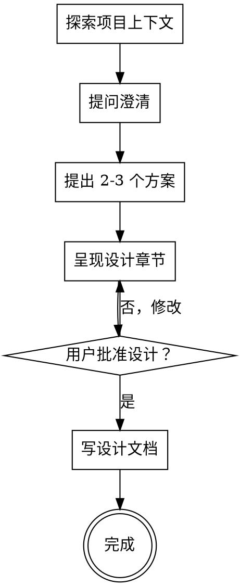

# 头脑风暴：从想法到设计

通过自然的协作对话，将想法转化为完整的设计和规格。

先理解项目上下文，再逐一提问细化想法。理解要构建什么后，呈现设计并获得用户批准。

<HARD-GATE>
在呈现设计并获得用户批准之前，禁止调用任何实现技能、编写任何代码、搭建任何项目或采取任何实现行动。这适用于每个项目，无论看起来多简单。
</HARD-GATE>

## 反模式："这个太简单不需要设计"

每个项目都要走这个流程。待办列表、单函数工具、配置变更 — 全部适用。"简单"项目恰恰是未审视的假设造成最多返工的地方。设计可以很短（真正简单的项目几句话即可），但必须呈现并获得批准。

## 检查清单

必须为以下每项创建任务，按顺序完成：

1. **探索项目上下文** — 检查文件、文档、近期提交；若存在 `CONTEXT.md` 则先读它（项目的统一语言）
2. **提问澄清** — 每次一个问题，理解目的/约束/成功标准；出现模糊或一词多义的领域术语时，按 `domain-modeling` 纪律当场挑战
3. **提出 2-3 个方案** — 含权衡分析和推荐
4. **呈现设计** — 按复杂度缩放各章节，逐段获得用户确认
5. **写设计文档** — 保存至 `docs/superpowers/specs/YYYY-MM-DD-<topic>-design.md`
6. **沉淀领域模型** — 每个敲定的术语即时写入 `CONTEXT.md`。完成态 = 规格 + 术语表同时落盘。

## 流程

**终止状态是规格审查批准。**

## 详细流程

**理解想法：**

- 先查看当前项目状态（文件、文档、近期提交）
- 在详细提问之前，评估范围：如果请求描述了多个独立子系统（如"构建一个包含聊天、文件存储、计费和分析的平台"），立即标记。不要在需要先拆解的项目上花时间细化细节。
- 如果项目太大无法用一个规格覆盖，帮助用户拆解为子项目：独立的部分有哪些、如何关联、应按什么顺序构建？然后按正常设计流程头脑风暴第一个子项目。每个子项目有独立的规格 → 计划 → 实现循环。
- 对范围合适的项目，每次一个问题细化想法
- 尽可能使用多选题，开放式也可以
- 每条消息只问一个问题 — 如需深入，拆成多个问题
- 聚焦理解：目的、约束、成功标准

**探索方案：**

- 提出 2-3 个不同方案及权衡分析
- 对话式呈现选项，给出推荐和理由
- 先说推荐方案，解释原因

**呈现设计：**

- 确信理解要构建什么后，呈现设计
- 按复杂度缩放每个章节：简单的几句话，复杂的 200-300 字
- 每个章节后问是否正确
- 覆盖：架构、组件、数据流、错误处理、测试
- 包含一节**领域术语（统一语言）**：本设计所依赖或新造的关键名词
- 随时准备回头澄清不理解的部分

**为隔离和清晰而设计：**

- 将系统拆成更小的单元，每个单元有单一明确目的，通过定义良好的接口通信，可独立理解和测试
- 对每个单元，应能回答：它做什么、怎么使用、依赖什么？
- 别人不看内部实现能理解单元做什么吗？改内部实现会破坏调用方吗？如果不能，边界需要优化。
- 更小、边界清晰的单元对你也更好 — 你对能同时放入上下文的代码推理更好，文件聚焦时编辑更可靠。文件变大通常是做了太多事的信号。

**在现有代码库中工作：**

- 提议变更前先探索当前结构。遵循现有模式。
- 现有代码存在问题且影响当前工作时（如文件过大、边界不清、职责混乱），将针对性改进纳入设计 — 像优秀的开发者改进正在工作的代码那样。
- 不提议无关的重构。聚焦服务当前目标。

## 设计完成后

**文档化：**

- 将验证通过的设计（规格）写入 `docs/specs/YYYY-MM-DD-<topic>-design.md`
  - （用户对规格位置的偏好覆盖此默认值）

**术语表与决策（DDD）：**

- 敲定的领域术语写入仓库根目录 `CONTEXT.md` — 纯词汇表，不含实现细节。第一个术语敲定时懒创建文件。格式见 `domain-modeling/CONTEXT-FORMAT.md`。
- 提问过程中术语一旦敲定**即时写入**，不要攒到最后。
- ADR（`docs/adr/`）只在决策同时满足三条时提议：难以逆转、无上下文会令人困惑、真实权衡的产物。格式见 `domain-modeling/ADR-FORMAT.md`。

## 关键原则

- **每次一个问题** — 不用多个问题淹没用户
- **优先多选题** — 比开放式更容易回答
- **严格 YAGNI** — 从所有设计中删除不必要的特性
- **探索替代方案** — 决定前始终提出 2-3 个方案
- **增量验证** — 呈现设计，获得批准后再继续
- **保持灵活** — 不理解时回头澄清
- **共享语言** — 每个术语在设计用它命名之前必须先有唯一规范含义；下游（规格、测试、代码）必须复用 `CONTEXT.md` 词汇
