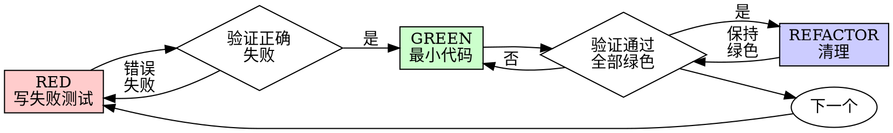

# 测试驱动开发（TDD）

## 概述

先写测试。看它失败。写最小代码通过。

**核心原则：** 如果你没看过测试失败，你不知道它测的是不是对的东西。

**违反规则的字面含义就是违反规则的精神。**

## 何时使用

**始终：**
- 新功能
- Bug 修复
- 重构
- 行为变更

**例外（问你的合作伙伴）：**
- 一次性原型
- 生成代码
- 配置文件

想着"就这次跳过 TDD"？停止。那是借口。

## 铁律

```
没有失败测试，不写生产代码
```

先写代码再写测试？删掉。重来。

**无例外：**
- 不留着当"参考"
- 不在写测试时"适配"它
- 不看它
- 删除就是删除

从测试出发重新实现。没有商量。

## Red-Green-Refactor



### RED — 写失败测试

写一个最小测试，展示期望发生什么。

<Good>
```typescript
test('重试失败操作 3 次', async () => {
  let attempts = 0;
  const operation = () => {
    attempts++;
    if (attempts < 3) throw new Error('fail');
    return 'success';
  };

  const result = await retryOperation(operation);

  expect(result).toBe('success');
  expect(attempts).toBe(3);
});
```
清晰的名称，测试真实行为，一件事
</Good>

<Bad>
```typescript
test('重试有效', async () => {
  const mock = jest.fn()
    .mockRejectedValueOnce(new Error())
    .mockRejectedValueOnce(new Error())
    .mockResolvedValueOnce('success');
  await retryOperation(mock);
  expect(mock).toHaveBeenCalledTimes(3);
});
```
模糊名称，测试的是 mock 不是代码
</Bad>

**要求：**
- 一个行为
- 清晰名称
- 名称中的领域术语来自 `CONTEXT.md`（如“Order 被 materialize”，而不是“文件被创建”）
- 真实代码（除非不得已才用 mock）

### 验证 RED — 看它失败

**必须执行。绝不跳过。**

```bash
npm test path/to/test.test.ts
```

确认：
- 测试失败（不是报错）
- 失败消息符合预期
- 因为特性缺失而失败（不是拼写错误）

**测试通过了？** 你在测试已有行为。修改测试。

**测试报错了？** 修复错误，重新运行直到正确失败。

### GREEN — 最小代码

写最简单的代码让测试通过。

<Good>
```typescript
async function retryOperation<T>(fn: () => Promise<T>): Promise<T> {
  for (let i = 0; i < 3; i++) {
    try {
      return await fn();
    } catch (e) {
      if (i === 2) throw e;
    }
  }
  throw new Error('unreachable');
}
```
刚好通过
</Good>

<Bad>
```typescript
async function retryOperation<T>(
  fn: () => Promise<T>,
  options?: {
    maxRetries?: number;
    backoff?: 'linear' | 'exponential';
    onRetry?: (attempt: number) => void;
  }
): Promise<T> {
  // YAGNI
}
```
过度设计
</Bad>

不添加功能、不重构其他代码、不"改进"到测试之外。

### 验证 GREEN — 看它通过

**必须执行。**

```bash
npm test path/to/test.test.ts
```

确认：
- 测试通过
- 其他测试仍然通过
- 输出干净（无错误、无警告）

**测试失败？** 修代码，不修测试。

**其他测试失败？** 立即修复。

### REFACTOR — 清理

绿色之后才能：
- 消除重复
- 改善命名（领域词汇必须与 `CONTEXT.md` 一致）
- 提取辅助函数

保持测试绿色。不添加行为。

### 重复

下一个失败测试，下一个功能。

## 好测试

| 品质 | 好 | 坏 |
|------|---|---|
| **最小** | 一件事。名称里有"和"？拆开。 | `test('验证邮箱和域名和空白')` |
| **清晰** | 名称描述行为 | `test('test1')` |
| **展示意图** | 展示期望的 API | 掩盖代码应该做什么 |

## 为什么顺序很重要

**"我之后再写测试验证它有效"**

后写的测试立即通过。立即通过证明不了什么：
- 可能测错了东西
- 可能测的是实现，不是行为
- 可能遗漏了你忘记的边界情况
- 你从没见过它捕获 bug

测试优先强制你看到测试失败，证明它确实测了东西。

**"我已经手动测试了所有边界情况"**

手动测试是临时的。你以为测试了一切，但：
- 没有记录测了什么
- 代码变更时无法重新运行
- 压力下容易遗漏
- "我试过没问题" ≠ 全面

自动化测试是系统化的。每次运行方式相同。

**"删除 X 小时的工作是浪费"**

沉没成本谬误。时间已经花了。现在的选择：
- 删除并用 TDD 重写（X 小时，高信心）
- 保留并事后加测试（30 分钟，低信心，可能藏 bug）

"浪费"是保留你不信任的代码。没有真正测试的工作代码是技术债。

**"TDD 是教条的，务实意味着灵活变通"**

TDD 就是务实的：
- 提交前找 bug（比事后调试快）
- 防止回归（测试立即捕获破坏）
- 文档化行为（测试展示如何使用代码）
- 支持重构（自由修改，测试捕获破坏）

"务实"的捷径 = 生产环境调试 = 更慢。

**"后写测试也能达到同样目的 — 重要的是精神不是仪式"**

不。后写测试回答"这段代码做什么？"先写测试回答"这段代码应该做什么？"

后写测试受你的实现偏差影响。你测的是你构建的，不是需要的。你验证的是记住的边界情况，不是发现的。

先写测试强制在实现前发现边界情况。后写测试验证你记住了一切（你没有）。

30 分钟的后写测试 ≠ TDD。你得到了覆盖率，失去了测试有效的证明。

## 常见借口

| 借口 | 现实 |
|------|------|
| "太简单不需要测" | 简单代码也会坏。测试只需 30 秒。 |
| "我之后再测" | 立即通过的测试证明不了什么。 |
| "后测也能达到同样目的" | 后测 = "代码做什么？" 先测 = "代码应该做什么？" |
| "已经手动测过了" | 临时 ≠ 系统化。没记录，无法重跑。 |
| "删 X 小时的工作是浪费" | 沉没成本谬误。保留未验证的代码是技术债。 |
| "留着当参考，先写测试" | 你会适配它。那就是后测。删除就是删除。 |
| "需要先探索" | 没问题。扔掉探索结果，从 TDD 开始。 |
| "测试难写 = 设计不清晰" | 听测试的。难测 = 难用。 |
| "TDD 会拖慢我" | TDD 比调试快。务实 = 测试优先。 |
| "手动测试更快" | 手动测不了边界情况。每次改动都要重测。 |
| "现有代码没有测试" | 你在改进它。为现有代码加测试。 |

## 红旗 — 停下来重来

- 先写代码后写测试
- 实现后再加测试
- 测试立即通过
- 无法解释测试为什么失败
- 测试"稍后"加
- 找借口"就这一次"
- "我已经手动测过了"
- "后写测试也能达到同样目的"
- "重要的是精神不是仪式"
- "留着当参考"或"适配现有代码"
- "已经花了 X 小时，删除是浪费"
- "TDD 是教条的，我是务实的"
- "这次情况不同因为……"

**以上都意味着：删除代码。用 TDD 重来。**

## 示例：Bug 修复

**Bug：** 空邮箱被接受

**RED**
```typescript
test('拒绝空邮箱', async () => {
  const result = await submitForm({ email: '' });
  expect(result.error).toBe('Email required');
});
```

**验证 RED**
```bash
$ npm test
FAIL: expected 'Email required', got undefined
```

**GREEN**
```typescript
function submitForm(data: FormData) {
  if (!data.email?.trim()) {
    return { error: 'Email required' };
  }
  // ...
}
```

**验证 GREEN**
```bash
$ npm test
PASS
```

**REFACTOR**
如需要，为多个字段提取验证逻辑。

## 验证清单

标记工作完成前：

- [ ] 每个新函数/方法有测试
- [ ] 看过每个测试失败
- [ ] 每个测试因正确原因失败（特性缺失，非拼写错误）
- [ ] 写了最小实现让每个测试通过
- [ ] 全部测试通过
- [ ] 输出干净（无错误、无警告）
- [ ] 测试使用真实代码（除非不得已才 mock）
- [ ] 边界情况和错误已覆盖

无法全部勾选？你跳过了 TDD。重来。

## 遇到困难时

| 问题 | 解决方案 |
|------|---------|
| 不知道怎么测 | 写期望的 API。先写断言。问合作伙伴。 |
| 测试太复杂 | 设计太复杂。简化接口。 |
| 必须 mock 所有东西 | 代码耦合太重。用依赖注入。 |
| 测试 setup 庞大 | 提取辅助函数。仍然复杂？简化设计。 |

## 调试集成

发现 bug？写一个复现它的失败测试。按 TDD 循环走。测试证明修复并防止回归。

绝不不带测试修 bug。

## 测试反模式

添加 mock 或测试工具时，阅读 @testing-anti-patterns.md 避免常见陷阱：
- 测试 mock 行为而非真实行为
- 在生产类中添加仅测试用的方法
- 在不理解依赖的情况下 mock

## 最终规则

```
生产代码 → 测试存在且先失败过
否则 → 不是 TDD
```

未经合作伙伴许可，无例外。
